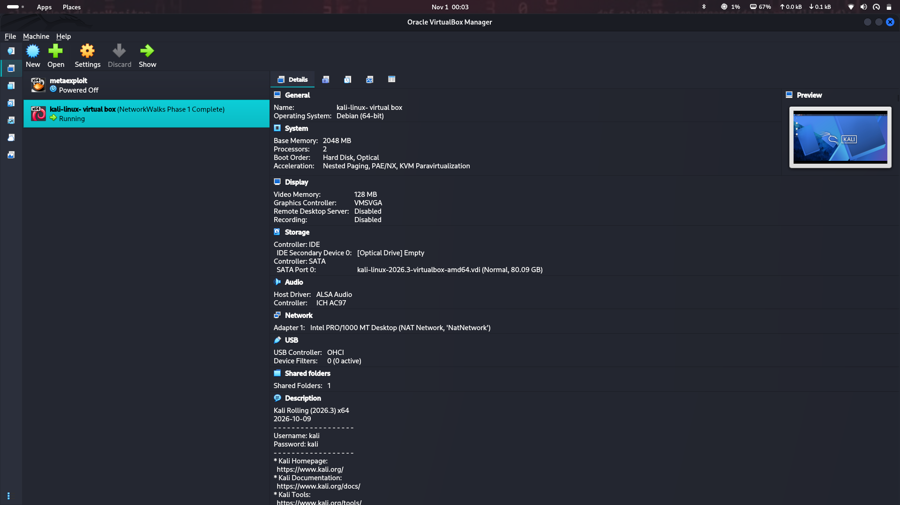
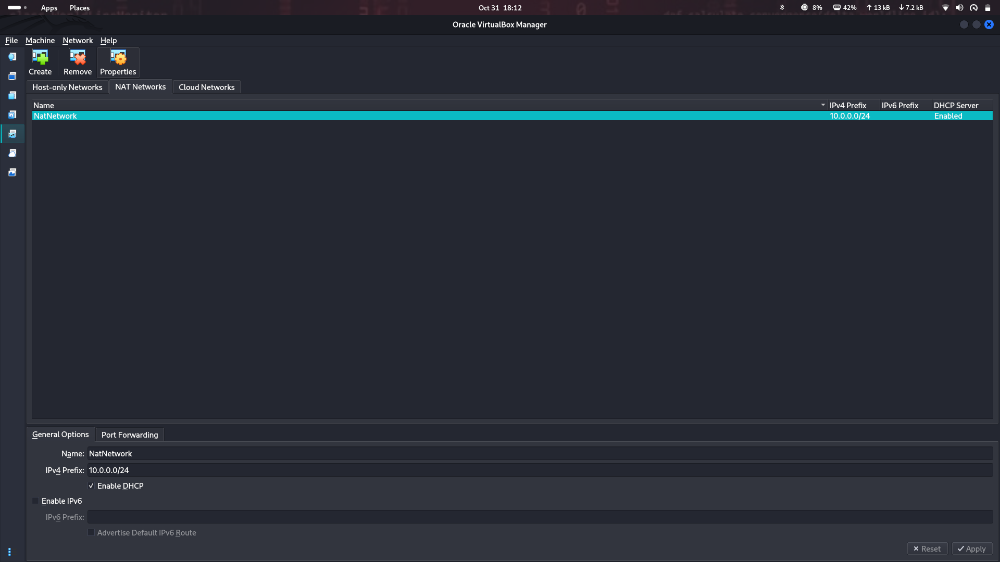
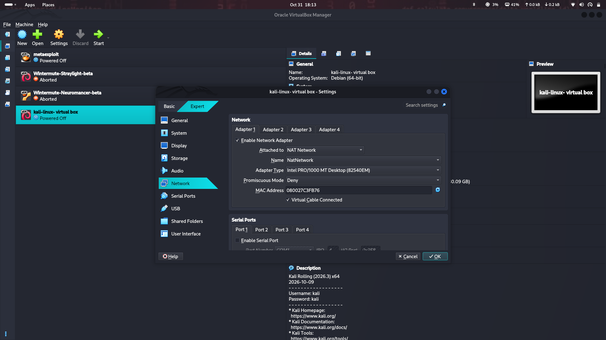
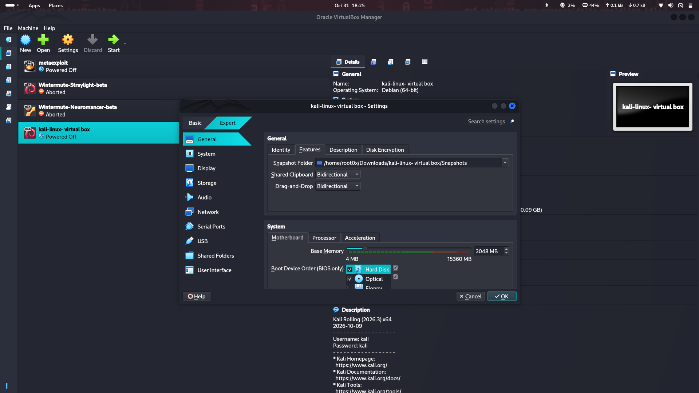
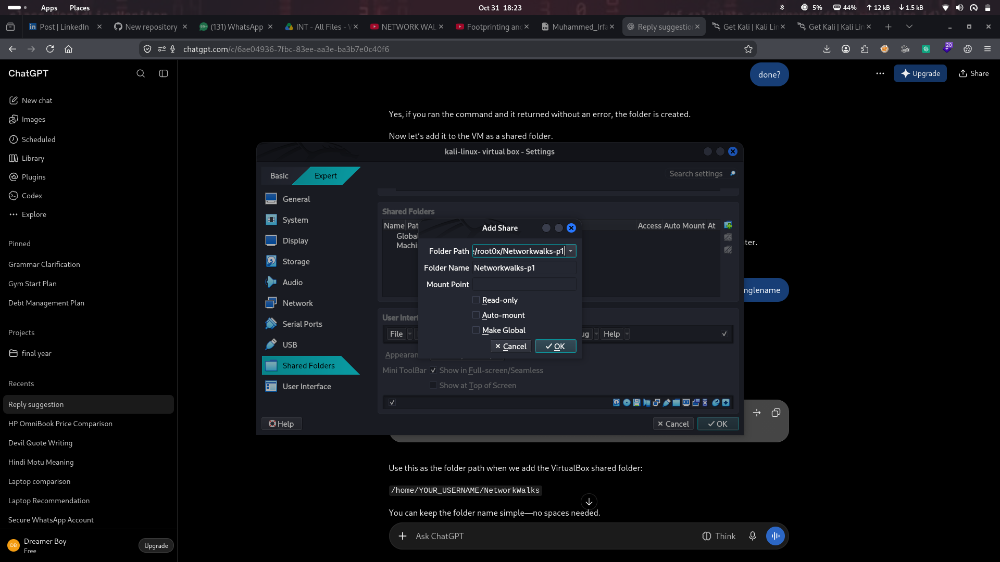
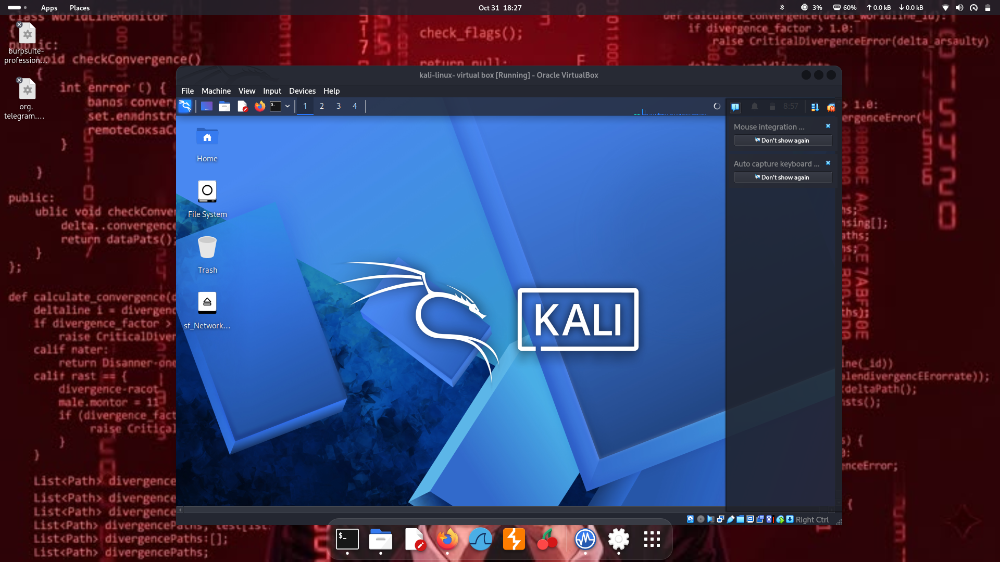
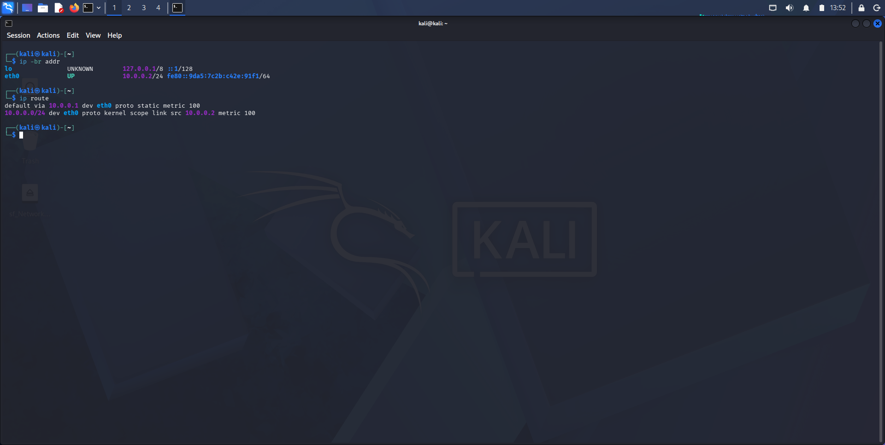
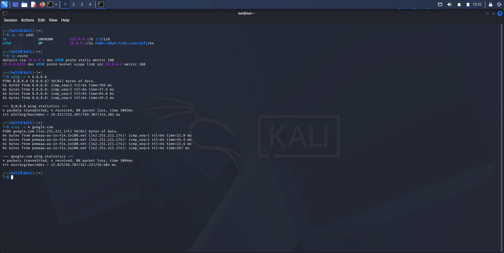
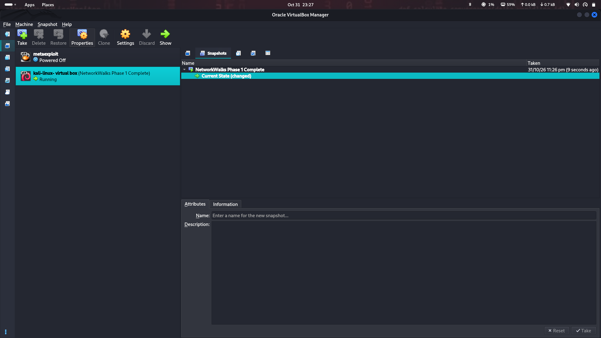

# 🔐 Cybersecurity Lab Environment Setup

<div align="center">

**Building an isolated virtual lab for cybersecurity and ethical hacking practice**

</div>

<p align="center">
  
  
  
  
  
  
</p>

---

## 📌 Project Overview

This project focuses on setting up a virtual cybersecurity and penetration-testing laboratory using **VirtualBox and Kali Linux**.

The objective is to create a controlled environment where cybersecurity tools, network scanning, reconnaissance, vulnerability assessment, and other security-testing activities can be practiced safely.

A dedicated **NAT Network** was configured to provide network connectivity for the Kali Linux virtual machine. The environment can be expanded later by adding additional virtual machines for authorized security testing.

---

## 🎯 Objectives

The main objectives of this project are to:

- Configure VirtualBox for virtualization.
- Import and configure Kali Linux as a virtual machine.
- Create a dedicated NAT Network.
- Configure network connectivity for Kali Linux.
- Assign and verify a consistent IPv4 address.
- Test gateway and Internet connectivity.
- Verify DNS resolution.
- Create a clean virtual-machine snapshot.
- Document the setup process with screenshots.
- Prepare the environment for future cybersecurity projects.

---

## 🛡️ Purpose of the Lab

This lab provides a controlled environment for cybersecurity learning and authorized security testing.

It can be used for activities such as:

- Network reconnaissance
- Port scanning
- Vulnerability assessment
- Packet analysis
- Web security testing
- Exploitation practice
- Security-tool experimentation

> ⚠️ **Ethical Use:** This laboratory is intended for educational purposes. Only test systems that you own or have explicit permission to assess. Do not use cybersecurity tools against unauthorized systems.

---

## 🏗️ Lab Architecture

The Kali Linux virtual machine is connected to a dedicated VirtualBox NAT Network.



The virtual network uses the `10.0.0.0/24` address range. Additional virtual machines can be connected to the same NAT Network in future projects.

---

## ⚙️ Lab Configuration

| Component | Configuration |
|---|---|
| Host Operating System | Kali Linux |
| Hypervisor | Oracle VirtualBox 7.2.20 |
| Guest Operating System | Kali Linux |
| Kali VM Memory | 2048 MB |
| Virtual Network | NAT Network |
| Network Name | `NatNetwork` |
| Network Address | `10.0.0.0/24` |
| Kali IPv4 Address | `10.0.0.2/24` |
| Default Gateway | `10.0.0.1` |
| DNS Used for Testing | `8.8.8.8` |
| Snapshot Name | `NetworkWalks Phase 1 Complete` |

---

# 🪜 Lab Setup Procedure

## Step 1. Configure VirtualBox

VirtualBox was used as the hypervisor to create and manage the Kali Linux virtual machine.


---

## Step 2. Create the NAT Network

A dedicated NAT Network was created in VirtualBox.

**Network configuration:**

```text
Network Name: NatNetwork
IPv4 Prefix:  10.0.0.0/24
```



A NAT Network allows virtual machines connected to the same network to communicate with one another while also providing outbound network connectivity.

This makes it suitable for building a multi-machine cybersecurity lab.

---

## Step 3. Configure the Kali VM Network Adapter

The Kali Linux virtual machine was configured to use the newly created NAT Network.



The network adapter was configured to connect to:

```text
Attached to: NAT Network
Network:     NatNetwork
```

The Kali VM was allocated **2048 MB of RAM**.

---

## Step 4. Configure Shared Folder and Clipboard

A shared folder was configured to support file transfer between the host system and the Kali Linux virtual machine.

Shared clipboard and drag-and-drop settings were also configured for easier interaction between the host and guest systems.





---

## Step 5. Start the Kali Linux VM

The Kali Linux virtual machine was started after completing the initial configuration.



---

## Step 6. Configure the Kali Linux Network

The Kali Linux network configuration was checked and configured with a consistent IPv4 address.

**Example network configuration:**

```text
IP Address:    10.0.0.2
Subnet Mask:   255.255.255.0
Gateway:       10.0.0.1
DNS:           8.8.8.8
```

A consistent IP address makes it easier to document the lab and reference the Kali machine during future exercises.



---

## Step 7. Verify Network Connectivity

Network connectivity was tested from the Kali Linux virtual machine.

The following tests were used:

```bash
ip a
ping 10.0.0.1
ping 8.8.8.8
ping google.com
```

These tests were used to check the IP configuration, gateway connectivity, Internet connectivity, and DNS resolution.



---

## Step 8. Create a Final clean VM Snapshot

After completing the initial setup, a VirtualBox snapshot was created.

**Snapshot name:**

```text
NetworkWalks Phase 1 Complete
```

The snapshot represents the baseline configuration of the laboratory.

If future experiments change or damage the VM configuration, the machine can be restored to this snapshot.



---

# 🔎 Lab Verification

| Test | Command | Result |
|---|---|---|
| Check IP address | `ip a` | Kali IP configuration checked |
| Test gateway | `ping 10.0.0.1` | Connectivity verified |
| Test Internet | `ping 8.8.8.8` | Connectivity verified |
| Test DNS resolution | `ping google.com` | DNS resolution verified |
| Verify snapshot | VirtualBox Snapshot Manager | Baseline snapshot created |

### Example Network Configuration

```text
Kali IP Address:
10.0.0.2/24

Default Gateway:
10.0.0.1

DNS Server:
8.8.8.8
```

---

# 🐞 Problems Encountered and Solutions

Documenting issues and their solutions is an important part of building a reliable cybersecurity lab.

## Network Configuration

During network configuration, the IP address, gateway, and DNS settings were checked to ensure that the Kali Linux VM could communicate with the virtual network and access the Internet.

The network was verified using `ip a` and ping tests.

> **Note:** Network interface names and NetworkManager connection names may differ between systems. Identify the correct interface or connection before changing network settings.

---

# 💡 What I Learned

Through this project, I learned how to create and configure a virtual environment for cybersecurity practice.

### 1. NAT vs. NAT Network

A standard NAT configuration and a NAT Network serve different purposes.

A NAT Network allows multiple virtual machines connected to the same virtual network to communicate with one another while providing outbound network connectivity.

### 2. Virtual Machine Networking

I learned how VirtualBox network adapters connect virtual machines to virtual networks and how network configuration affects communication.

### 3. IPv4 Configuration

I learned how to configure and verify IPv4 addresses, subnet masks, gateways, and DNS settings in Kali Linux.

### 4. Network Verification

I practiced using commands such as `ip a` and `ping` to verify network configuration and connectivity.

### 5. VM Snapshots

I learned that a clean snapshot should be created before performing risky or experimental activities.

This provides a known-good recovery point for future cybersecurity exercises.

### 6. Documentation

I learned that documenting configurations, commands, screenshots, and verification results is an important part of a professional cybersecurity project.

---

# 🔐 Security and Ethical Use

This laboratory is intended strictly for educational purposes and authorized security testing.

All testing must be performed only on systems that I own or have explicit permission to assess.

---

# 🔗 Tools and Resources

- **VirtualBox:** [https://www.virtualbox.org/wiki/Downloads](https://www.virtualbox.org/wiki/Downloads)
- **Kali Linux:** [https://www.kali.org/get-kali/](https://www.kali.org/get-kali/)
- **NetworkWalks:** [https://networkwalks.com/central-int](https://networkwalks.com/central-int)

---

# 👤 Author

**Muhammad Irfan**  
Cybersecurity Learner | B084 

GitHub: [muhdirfan-cyber](https://github.com/muhdirfan-cyber)

---

## 📌 Project Information

| Field | Details |
|---|---|
| Program | Cybersecurity at NetworkWalks |
| Week | 01 |
| Project | Cybersecurity and Pentesting Lab Setup |
| Platform | GitHub |
| Repository | [networkwalks-week1-cybersecurity-lab-setup](https://github.com/muhdirfan-cyber/networkwalks-week1-cybersecurity-lab-setup) |

---

**Week 1 — Cybersecurity Lab Environment Setup Completed.**
